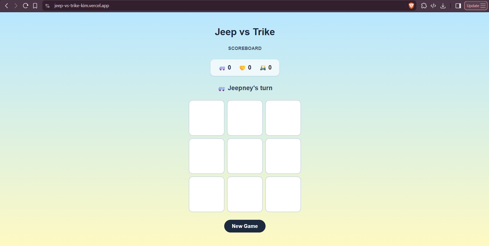

# 🚐 Jeep vs 🛺 Trike

A Filipino-themed tic-tac-toe game. Two players take turns as the Jeep or the Trike, and the first to line up three wins the road.

**Live demo:** https://jeep-vs-trike-kim.vercel.app/



## Features

- Two players take turns on a 3x3 board
- Shows the winner (with the winning line highlighted) or a draw
- New Game button to start over
- Scoreboard that counts Jeep wins, Trike wins, and draws
- Pop animation when a mark is placed
- Responsive layout

## Tech Stack

- [Next.js](https://nextjs.org/) (App Router)
- React
- TypeScript
- Tailwind CSS
- Deployed on Vercel

## Run Locally

```bash
git clone https://github.com/kapadilla/jeep-vs-trike.git
cd jeep-vs-trike
npm install
npm run dev
```

Then open [http://localhost:3000](http://localhost:3000).

## Project Structure

```
app/          Next.js app (layout, page, styles, favicon)
components/   Game (state and logic) and Board (UI)
lib/game.ts   Win detection and shared constants
```

## How I Used AI

- Used Claude to plan the theme and generate the first version of the components (`Game`, `Board`, and the `calculateWinner` helper).
- I set up the project, ran and tested it myself, and customized the theme, icons, and scoreboard.
- I fixed a few issues along the way:
  - Renamed the component files from `.ts` to `.tsx` after TypeScript errors on the JSX.
  - Fixed the scoreboard text being unreadable by setting an explicit text color.
  - Swapped the 🚙 SUV emoji for 🚐 since it looks closer to a jeepney.
- Tested edge cases by hand: winning on the last move, draws, clicking filled squares, clicking after the game ends, all 8 winning lines, and New Game mid-game.

## What I'd Improve With More Time

- Custom jeepney and tricycle SVG art instead of emoji
- Save the score in local storage
- Optional play vs computer mode